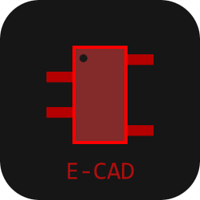

# e-cad — САПР топологии печатных плат

**e-cad** — настольная программа для рисования схем-рисунков (топологии) печатных плат
и микроэлектронных узлов. Принцип — «Just Draw It»: проводники, контакты, полигоны и
маркировка рисуются мышью прямо на поле, как на бумаге, без принципиальных схем и без
netlist (подход Sprint-Layout). Интерфейс выполнен в стиле **Material Design 3**.



---

## Блок «Инструкция по использованию» (кратко)

Полная инструкция из 13 блоков встроена в программу: **Справка → Инструкция по
использованию** (клавиша `F1`), либо кнопка «?» в правом верхнем углу.

### 1. Установка и запуск

```bash
pip install -r requirements.txt
python main.py          # или запустите run.bat
```

Требуется Python 3.10+. Проекты сохраняются в собственном формате `*.ecad`
(мультиплатный), автосохранение — `*.BAK` рядом с файлом.

Готовые сборки: вкладка **Actions** → запуск workflow «Сборка e-cad»
(артефакт `e-cad-windows`); тег `v1.1.0` создаёт релиз с `e-cad.exe`.
Локальная сборка: `pyinstaller --windowed --name e-cad --add-data "assets;assets" main.py`

### 2. Структура интерфейса

| Область | Содержимое |
|---|---|
| Слева | 16 инструментов, настройки сетки, мини-карта, кнопки открытия панелей |
| Центр | рабочее поле с координатными линейками и сеткой |
| Справа | Библиотека макросов · Свойства · DRC · Фильтр · Компоненты · Фотовид |
| Снизу | координаты, кнопки слоёв (активный — с точкой), Автозахват / Эластик / Металлизация |
| Под полем | закладки плат мультиплатного проекта |

### 3. Инструменты (16 режимов)

| Инструмент | Клавиша | Назначение |
|---|---|---|
| Курсор | `Esc` | Выбор и перемещение; ПКМ сбрасывает инструмент |
| Масштаб | `Z` | ЛКМ — плюс, ПКМ — минус, рамка — зум на участок |
| Дорожка / Линия | `T` | Проводник заданной ширины, ПКМ — завершить |
| Контакт THT | `P` | Площадки сквозного монтажа, `F12` — металлизация |
| SMD-контакт | `S` | Прямоугольные площадки поверхностного монтажа |
| Круг / Дуга | `R` | Окружность, круг с заливкой, дуга |
| Полигон | `F` | Контур произвольной формы; `Enter` — замкнуть |
| Текст | `L` | Надпись; двойной щелчок — правка |
| Прямоугольник | `Q` | ЛКМ + протяжка |
| Фигура | `N` | Правильный многоугольник, спираль, матрица |
| Маска | `O` | ЛКМ по элементу — открыть/закрыть окно маски |
| Линии связи | `C` | Виртуальные соединения между контактами |
| Автотрасса | `A` | Point-to-point трассировщик |
| Контроль (тест) | `X` | Щуп: подсвечивает всю цепь на всех слоях |
| Измеритель | `M` | ΔX, ΔY, расстояние, угол |
| Фотовид | `V` | Вид «как изготовлена», Верх/Низ |

### 4. Слои

`М1` (верхняя медь) · `К1` (верхняя маркировка) · `В1`/`В2` (внутренние, включаются
флажком «Многослойная») · `М2` (нижняя медь) · `К2` (нижняя маркировка) · `О`
(контур и вырезы). Медных слоёв только 2 или 4. Переключение `F9`, клик по имени слоя
включает/выключает отображение. Нижние слои отображаются «прозрачной платой».

### 5. Порядок работы

1. **Файл → Новый** — один из трёх шаблонов.
2. **Плата → Свойства платы** — размеры, при необходимости «Многослойная».
3. Контур платы на слое **О** (Прямоугольник или Полигон).
4. Компоненты из **Библиотеки макросов** или **Мастером площадок** (Опции).
5. **Линии связи** (`C`) — показывают неразведённые соединения.
6. Дорожки вручную или **автотрассой** (`A`), переходные отверстия — `P` + `F12`.
7. **Металлизация** (Авто-земля) в статус-баре; вырезы — флажок «Негативно».
8. **Маска** (`O`) — открыть окна только под пайку.
9. **DRC** — исправить ошибки, проверить тонкие «мостики» заливки.
10. Экспорт Gerber + Excellon + Pick+Place/BOM, сохранение проекта.

### 6. Горячие клавиши

| Клавиши | Действие |
|---|---|
| `Esc` | сброс инструмента, отмена действия |
| `1…9` | девять заданных шагов сетки |
| `F9` / `F12` | верх-низ / металлизация выбранного контакта |
| `F1` | инструкция |
| `Ctrl` / `Shift` / `Alt` | снять привязку / мелкий шаг / элемент внутри группы |
| `Ctrl+Z`, `Ctrl+Y`, `Del` | отменить, восстановить, удалить |
| `Ctrl+R/T/H/G/U/W` | повернуть, зеркалить, сгруппировать, на противоположный слой |
| `Ctrl+P` | печать 1:1 |

### 7. Экспорт для производства

Gerber RS-274X (медь, маркировка, маска, трафарет под пасту), Excellon (раздельно
металлизированные/нет, сортировка по диаметру), HPGL (изоляция + сверление + контур +
реперные метки), Pick+Place/BOM, PNG/JPG/GIF/BMP/PDF, печать реального размера 1:1 с
пресетами ЛУТ.

---

## Возможности

* 7 слоёв, многослойность 2/4, прозрачное отображение нижних слоёв.
* 16 инструментов, привязка, автозахват, резиновые дорожки, сетка до 1 мкм,
  мм/милы, горячие шаги сетки.
* Авто-земля (металлизация) с индивидуальными зазорами и термобарьерами с лучами.
* DRC: 11 правил, режимы «Вся плата / Окно», переход к ошибке двойным щелчком.
* Компоненты (RefDes/Value/Comment), лист компонентов, экспорт Pick+Place и BOM.
* Библиотека макросов: 65 посадочных мест, дерево, предпросмотр, постановка под
  курсор, версионирование набора.
* Мастер площадок (SIP/DIP/QUAD/кольцо/двойное кольцо) с предпросмотром.
* Импорт Gerber RS-274X + Excellon, фоновый шаблон BMP/JPG, текстовый импорт/экспорт.
* Мультиплатный проект, автосохранение, undo/redo настраиваемой глубины.
* Светлая и тёмная тема Material Design 3, сворачиваемая левая панель.

## Библиотека компонентов (макросов)

| Группа | Состав |
|---|---|
| Резисторы | 0603/0805/1206/2010 SMD, выводной 0,25 Вт, подстроечный 3296W, сеть (SOIC-9) |
| Конденсаторы | 0603/0805/1206 SMD, радиальный выводной, электролит SMD, тантал A-case, триммер |
| Диоды | 1N4007 DO-41, Шоттки SOD-123, светодиоды 5 мм и SMD, стабилитрон BZT52 |
| Транзисторы | SOT-23-3, TO-92, SOT-223-4, TO-220 |
| Корпуса | SOIC-8/14/16/20/28, TSSOP-20, SSOP-28, MSOP-8, LQFP-32/64, TQFP-44/100, QFN-24, SOP-8, DIP-8/14/16, PLCC-20 |
| Индуктивности | SMD 0805, выводная, дроссель 4×4×3, трансформатор |
| Кварцы | HC-49/S, SMD 3225, керамический резонатор 3 вывода |
| Кнопки | тактовая 6×6×4 (4 вывода), SMD 3×4 |
| Разъёмы | штырьковые 2…10 контактов, USB-A, питание, винтовая клемма, держатель CR2032 |
| Прочее | MOSFET SO-8, DRV8833 WSON, ESP-WROOM-32, адаптер 2 отверстия |

Новые макросы добавляются автоматически при запуске (папка
`Документы/e-cad/Makros`, файлы версионируются — устаревшие обновляются).

## Структура проекта

```
e-cad/
├── main.py                     точка входа
├── run.bat                     запуск двойным щелчком
├── assets/logo.png             логотип
└── ecad/
    ├── core/                   модель и алгоритмы (без Qt)
    │   ├── geom.py             геометрия, растеризация, заливка
    │   ├── model.py            слои, элементы, платы, компоненты, связность
    │   ├── fill.py             авто-земля и термобарьеры
    │   ├── drc.py              проверка условий
    │   ├── exporters.py        Gerber / Excellon / HPGL / Pick+Place / BOM
    │   ├── importers.py        импорт Gerber и Excellon
    │   └── tools_lib.py        макросы, мастер площадок, автотрасса
    └── ui/
        ├── theme.py            токены Material Design 3 и QSS
        ├── canvas.py           холст, инструменты, сетка, линейки
        ├── panels.py           панели интерфейса
        ├── dialogs.py          диалоги (текст, фигура, экспорт, печать…)
        ├── dialogs_board.py    диалоги платы, импорта и шаблона
        ├── render.py           рендер в изображение / PDF / принтер
        ├── helpwindow.py       блок «Инструкция по использованию»
        ├── about.py            блок «Актор»
        └── main_window.py      меню и сборка окна
```

## Ограничения

Нет принципиальных схем и netlist; автотрассировщик только point-to-point; DRC не
проверяет полигон авто-земли; печать из фотовида невозможна; один файл — один
мультиплатный проект.

---

## Блок «Актор»

Автор и разработчик: **miiko3**

**Автор · соцсети и поддержка**

| Ресурс | Ссылка |
|---|---|
| ВКонтакте | https://vk.ru/seller_tg |
| ЮMoney | https://yoomoney.ru/fundraise/1GJCNQ28KCK.260319 |
| Boosty | https://boosty.to/miilo3 |

**Репозитории**

| Ссылка | URL |
|---|---|
| e-cad (исходный код) | https://github.com/miiko3/e-cad |
| Все репозитории автора | https://github.com/miiko3?tab=repositories ||